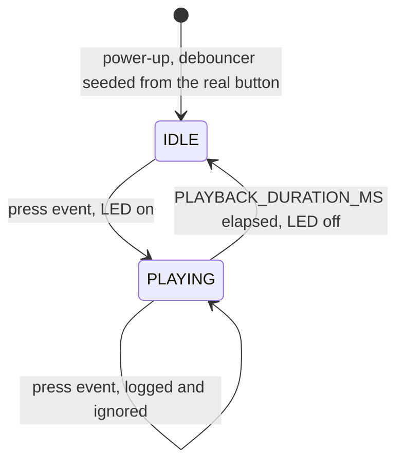

# Button-triggered playback

Firmware for a Raspberry Pi Pico (RP2040) based board. A visitor presses a button and a timed output signal runs. For now the status LED stands in for real playback (i.e. BrightSigns and sound-modules). Presses during playback are ignored, and a held button triggers only once.

## Hardware

| Signal     | GPIO | Notes                                                                                                                                    |
| ---------- | ---- | ---------------------------------------------------------------------------------------------------------------------------------------- |
| Button     | 22   | Active low: button to GND with an external pull-up. The internal pulls are disabled in firmware.                                         |
| Status LED | 25   | The Pico's onboard LED. On the Pro Micro, GPIO 25 drives the WS2812, so wire an external LED to another pin and change `STATUS_LED_PIN`. |

## How it works

Every pass of the main loop does the same three things, and never waits:

```
read clock + button  →  debouncer.update()  →  state machine  →  LED / printf
     (sense)                (clean up)            (decide)          (act)
```

### Playback state machine



The debouncer is updated on every pass in both states, so a press during playback is used up immediately instead of starting another playback when this one ends.

### Debouncing

```
                  press + bounces                 release + bounces
raw       __________|‾|_|‾|_|‾‾‾‾‾‾‾‾‾‾‾‾‾‾‾‾‾‾‾‾‾‾‾‾‾|_|‾|_____________
                    ^ ^ ^ ^ ^                         ^ ^ ^
                            ├───────┤                     ├───────┤
                              20 ms                         20 ms
stable    __________________________|‾‾‾‾‾‾‾‾‾‾‾‾‾‾‾‾‾‾‾‾‾‾‾‾‾‾‾‾‾|_____
                                    ▲                             ▲
                              true (press)                  false (release)
update()  __________________________|‾|_________________________________
                                    ▲                             ▲
                              true only during press        false elsewhere and upon release
```

Every change in the raw reading restarts a stopwatch, so bounces are never accepted. Once the reading has been steady for `DEBOUNCE_MS`, it becomes the stable state. `update()` returns true only on the pass where the stable state becomes pressed, which makes it an event rather than a state: holding the button produces one press, not a stream of them.

## Files

| File              | Contents                                                                                                                 |
| ----------------- | ------------------------------------------------------------------------------------------------------------------------ |
| `src/main.cpp`    | Pin setup, hardware helpers and the playback state machine                                                               |
| `src/debouncer.h` | The `Debouncer` class. Pure logic with no Pico SDK calls, so it can be reused for other inputs and tested on a computer. |

## Configuration

| Constant                       | Default | Meaning                                                       |
| ------------------------------ | ------- | ------------------------------------------------------------- |
| `DEBOUNCE_MS`                  | 20      | How long the raw reading must be steady before it is accepted |
| `PLAYBACK_DURATION_MS`         | 5000    | How long each playback lasts                                  |
| `BUTTON_PIN`, `STATUS_LED_PIN` | 22, 25  | GPIO numbers                                                  |

## Build and flash

```zsh
cmake -S . -B build/pico -G Ninja -DPICO_BOARD=pico
cmake --build build/pico
picotool load -f build/pico/<project>.uf2
```

The `.uf2` is named after the project in `CMakeLists.txt`. `picotool load -f` only works when the firmware already on the board has USB enabled; for the first upload, hold BOOTSEL while plugging in.

## Tests to run after changes

| Test                           | Expected                                                            |
| ------------------------------ | ------------------------------------------------------------------- |
| One press                      | One 5 s playback, then the LED turns off and the button works again |
| Hold the button for 12 s       | Exactly one playback                                                |
| Tap during playback            | Logged as ignored; playback is unaffected                           |
| Power up with the button held  | Nothing until the button is released and pressed again              |
| Bare jumper wire tapped to GND | One press per tap                                                   |
